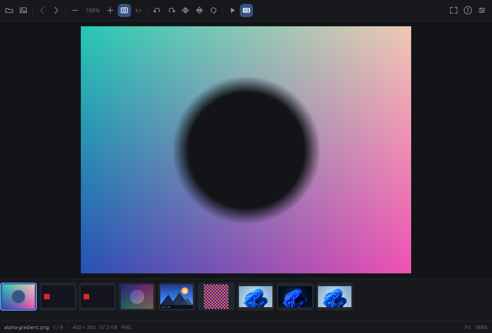
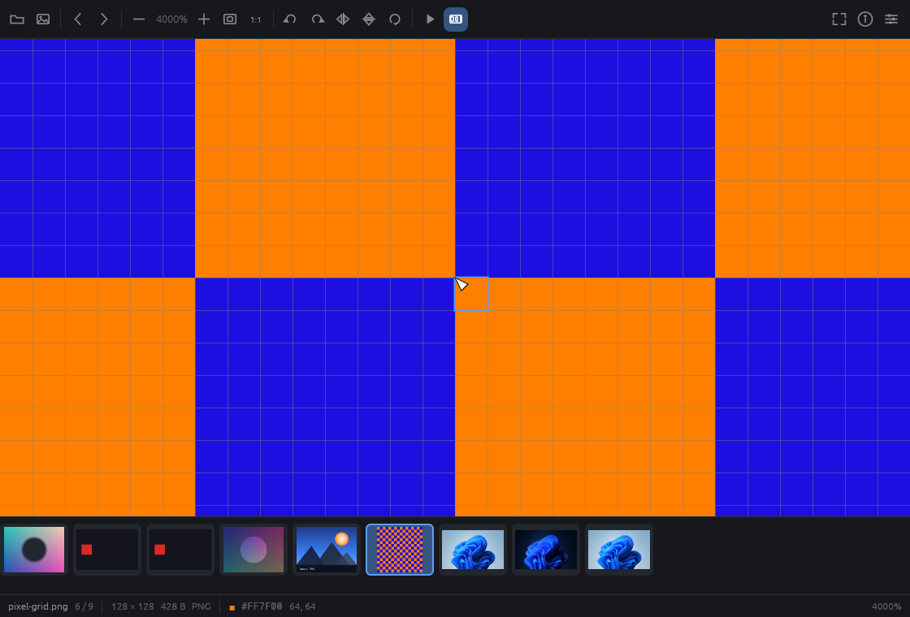
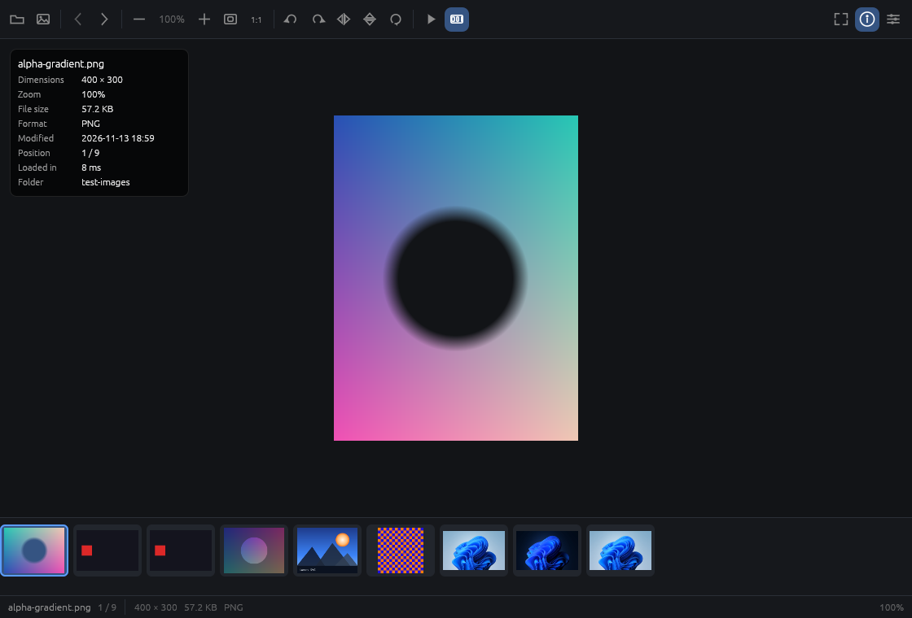
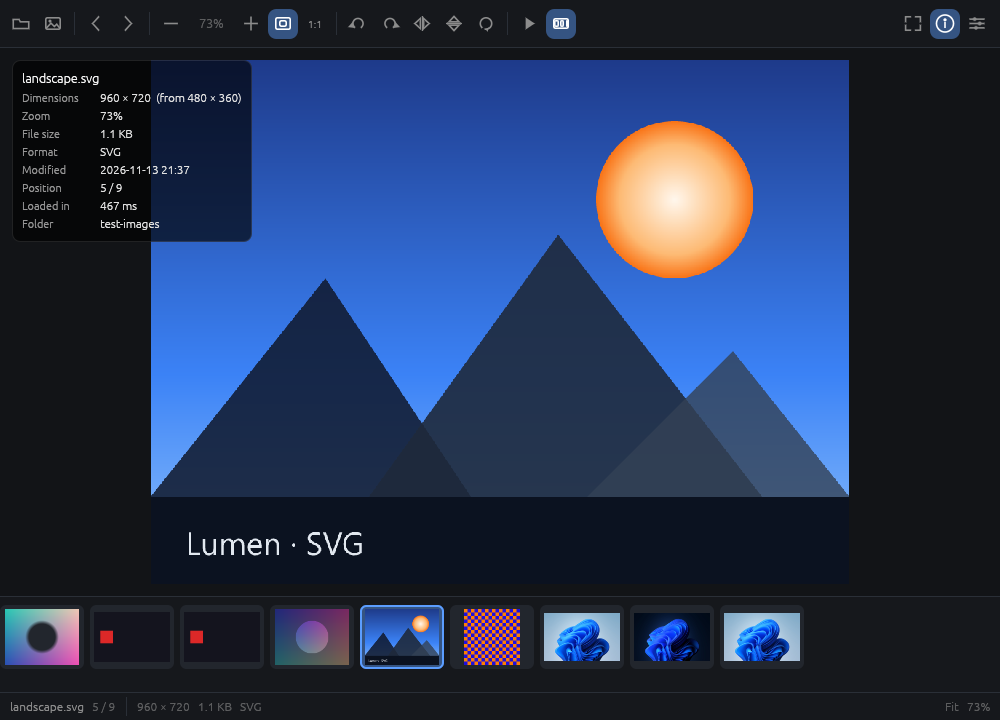
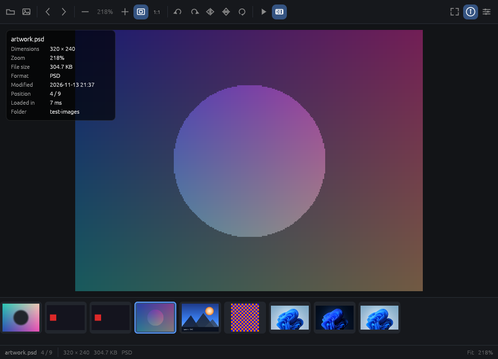
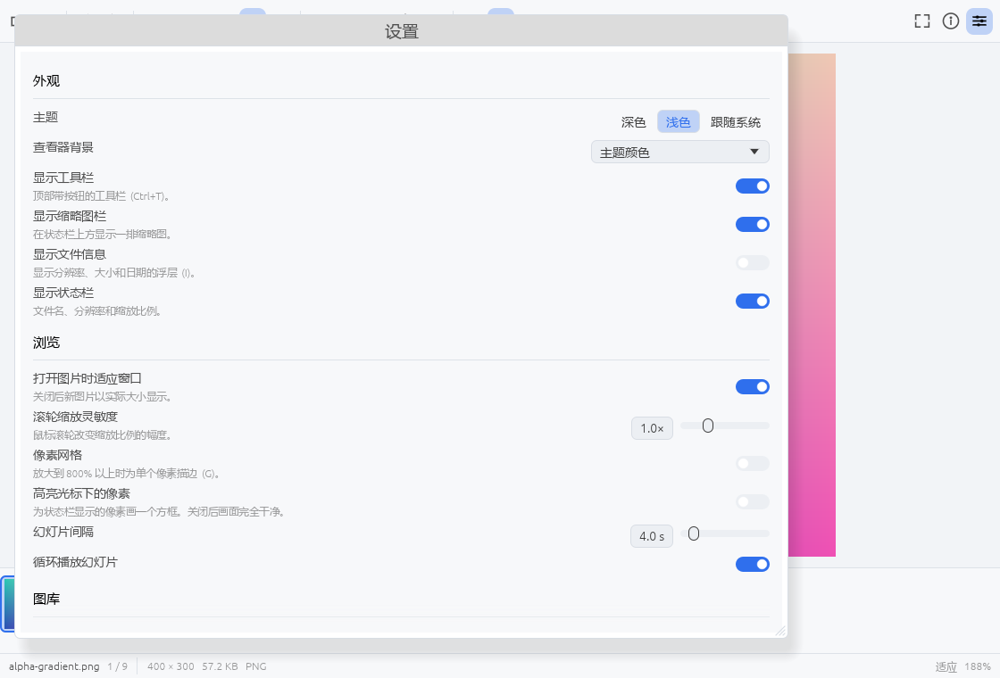
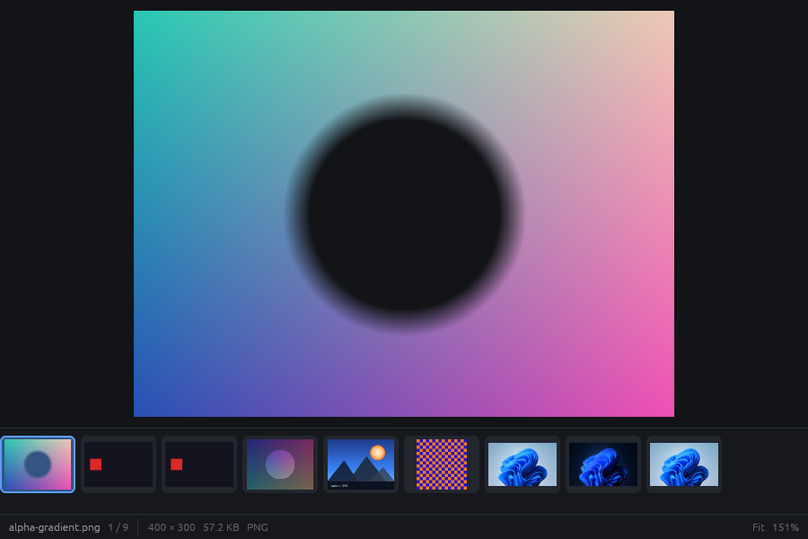

# Lumen

A fast, portable photo viewer for Windows, written in Rust with [egui](https://github.com/emilk/egui).

One executable, no installer, no runtime DLLs, no telemetry. Double-click a photo and it is on
screen in about a fifth of a second.



## Why another image viewer

- **It starts instantly.** The window is up before the first photo is decoded; decoding,
  thumbnails and file metadata all happen on background threads. Measured 206–218 ms from
  process start to the first painted frame on the development machine.
- **It is one file.** A single ~15 MB `lumen.exe` with a statically linked C runtime. Copy it
  anywhere, including a USB stick — put an empty `lumen.portable` file next to it and the
  settings travel with it.
- **It reads what you actually have.** 15 image formats — from JPEG and PNG to OpenEXR, DDS and
  QOI — plus SVG and PSD, and animated GIF and APNG. All of it without shipping libjpeg,
  librsvg or any other system library.
- **It gets out of the way.** Flat theme-coloured background by default, no toolbars floating
  over the picture, and the panels you do not need can be hidden.

## Features

**Viewing**
- Fit-to-window or 1:1, wheel zoom anchored under the cursor (2 %–4000 %)
- Rotate in 90° steps, mirror horizontally and vertically, one key to reset the view
- Pixel-level inspection: zoom past 800 % for a crisp nearest-neighbour view, optional pixel
  grid, and a live readout of the colour and coordinates under the cursor
- EXIF orientation is applied, so phone photos are not shown sideways
- Animated GIF and APNG playback with correct frame disposal, blending and delays
- Optional file-information overlay, status bar and filmstrip

**Browsing**
- Opens folders or single files, remembers the last session
- Natural sort (`photo2` before `photo10`), or sort by date or size
- Filmstrip with lazy thumbnails that keep loading while you scroll
- Slideshow with adjustable interval and looping
- Drag and drop, fullscreen, `←`/`→` navigation

**Interface**
- English and Chinese, following the system language by default
- Light, dark and system themes; four viewer backgrounds including a checkerboard
- Settings and keyboard shortcuts open in their own windows, not over the photo
- The window size, position and maximised state are remembered between runs

**System integration**
- Optional registration as the default photo viewer — everything is written under
  `HKEY_CURRENT_USER`, so it never needs administrator rights
- The executable carries its icon and version information
- Crash log and an opt-in diagnostic log

## Screenshots

| Pixel inspection | File information |
|---|---|
|  |  |

| SVG | PSD |
|---|---|
|  |  |

| Settings (separate window) | Toolbar hidden |
|---|---|
|  |  |

## Supported formats

| Kind | Formats |
|---|---|
| Photographs | JPEG (`.jpg`, `.jpeg`, `.jfif`), PNG, WebP, TIFF, BMP |
| Animation | GIF, APNG (`.png`, `.apng`) |
| Vector | SVG (`.svg`, `.svgz`) |
| Documents | PSD (Photoshop, flattened composite) |
| Textures and HDR | TGA, DDS (DXT1/3/5), HDR, OpenEXR |
| Icons and others | ICO, QOI, Farbfeld, PNM (PBM, PGM, PPM, PAM) |

PSD support reads the composite image that Photoshop stores at the end of the file, which is
what you see when every layer is visible: RGB and grayscale, 8 and 16 bits per channel, raw and
RLE compressed. PSB, CMYK, Lab, indexed and 32-bit float files are refused with a clear message
rather than shown incorrectly.

SVG is rasterised at twice its declared size (capped at 2048 px), so it stays sharp when zoomed
in. Text in SVG uses the fonts installed on the system.

Not supported: HEIC/HEIF and AVIF. Both need codecs that would either break the
single-file promise or add a large C dependency, which this project deliberately avoids.

## Keyboard shortcuts

| Keys | Action |
|---|---|
| `←` `→` / `PageUp` `PageDown` | Previous / next image |
| `Home` `End` | First / last image |
| `+` `-` | Zoom in / out |
| `0` / `1` | Fit to window / actual size |
| `R` / `Shift`+`R` | Rotate left / right |
| `H` / `V` | Flip horizontally / vertically |
| `Ctrl`+`0` | Reset rotation, flip and zoom |
| `Space` | Start / stop the slideshow |
| `I` | Toggle the file information overlay |
| `T` / `Ctrl`+`T` | Toggle the filmstrip / the toolbar |
| `G` | Toggle the pixel grid |
| `F11` | Toggle fullscreen |
| `Ctrl`+`,` | Open settings |
| `F1` | Show the shortcut list |
| `Ctrl`+`O` / `Ctrl`+`Shift`+`O` | Open a folder / a file |
| `Esc` | Close a window, or leave fullscreen |

## Building

Requirements:

- Windows 10 or 11
- Rust 1.85 or newer with the MSVC toolchain (`rustup default stable-msvc`)
- The Windows SDK, for `rc.exe` — used once by the build script to embed the icon and version
  information. If it is missing the build still succeeds, just without an icon.

```sh
git clone https://github.com/ChathamHung/Lumen.git
cd Lumen
cargo build --release
```

The result is `target/release/lumen.exe`. Nothing else is needed to run it.

### Command line

```
lumen.exe                  # opens empty, or the last session
lumen.exe C:\photos        # opens a folder
lumen.exe C:\photos\a.jpg  # opens a file
lumen.exe --register       # register as a photo viewer for the current user
lumen.exe --unregister     # undo that
```

### Environment variables

| Variable | Effect |
|---|---|
| `LUMEN_RENDERER=glow\|wgpu` | Force a rendering backend (default: OpenGL, with an automatic DirectX 12 fallback) |
| `LUMEN_LANG=en\|zh` | Override the interface language |
| `LUMEN_LOG=1` | Write `lumen.log` next to the settings file |
| `LUMEN_TRACE_STARTUP=1` | Write the measured startup time to `startup.txt` |
| `LUMEN_FONT=<path>` | Use a specific font for Chinese text |
| `LUMEN_CONFIG_DIR=<path>` | Keep settings somewhere else (used by the tests) |

## Configuration

Settings live in `%APPDATA%\Lumen\`:

- `settings.json` — everything on the settings page, plus the last session
- `window.json` — size, position and maximised state of the main window

Create an empty file called `lumen.portable` next to `lumen.exe` and both files are kept in that
folder instead, so the whole application fits on a USB stick.

Settings can be exported and imported from the settings page, which is also the easiest way to
carry them to another machine.

## Project layout

| File | Responsibility |
|---|---|
| `src/main.rs` | Startup, renderer selection, window creation |
| `src/app.rs` | Application state, layout and interaction |
| `src/viewer.rs` | Zoom / pan / rotation / mirror maths and the canvas painter |
| `src/image_loader.rs` | Background decoding, EXIF orientation, animations, textures |
| `src/psd.rs` | Photoshop composite reader |
| `src/library.rs` | Folder scanning, natural sort, navigation |
| `src/settings.rs` | Persistent settings and import/export |
| `src/window_state.rs` | Remembered window geometry |
| `src/i18n.rs` | English and Chinese strings |
| `src/theme.rs` | Palettes, fonts, checkerboard |
| `src/icons.rs` | Every icon, drawn in code |
| `src/platform.rs` | File associations and Explorer integration |
| `build.rs`, `assets/` | Icon and version resource embedded into the executable |

## Testing

```sh
cargo test
```

The suite (48 tests) covers folder scanning and sorting, the view transform (including every
combination of rotation and mirroring), every supported format decoded end to end, the PSD
reader, the animation decoder, and the UI itself: eighteen tests render the real application
offscreen through wgpu with [`egui_kittest`](https://github.com/emilk/egui/tree/main/crates/egui_kittest)
and write PNGs to `shots/`, which is how layout and colour changes are checked on a machine
whose GPU driver cannot present a window.

Two tools generate assets that are checked in:

```sh
python tools/make_icon.py   # assets/lumen.ico from the same geometry as src/icons.rs
python tools/make_psd.py    # test-images/artwork.psd, written independently of the reader
```

## Licence

MIT — see [LICENSE](LICENSE).

The bundled fonts (Ubuntu-Light, NotoEmoji, Hack) come from egui and keep their own licences.
The icons are drawn in code rather than shipped as assets, and the images in `test-images/` are
small fixtures used by the tests.
